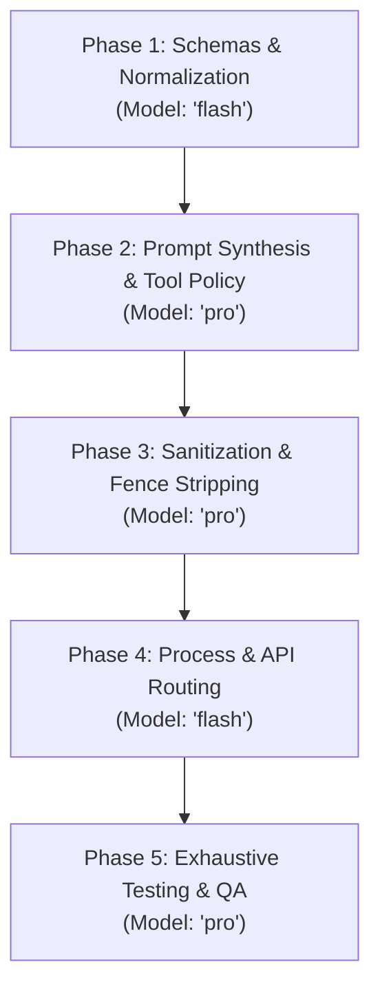

# Implementation Plan - Issue #3: Support OpenAI response_format (json_schema / json_object) and Strip Markdown Code Fences

**Issue ID**: #3  
**Target File**: [`docs/plans/plan_3.md`](file:///home/roukine/workspaces/karaagy/docs/plans/plan_3.md)  
**Status**: DRAFT  
**Author**: Antigravity High-Reasoning Planning Subagent  
**Date**: 2026-10-20  

---

## 1. Problem Analysis & Root Cause

### 1.1 Context
When OpenAI-compatible clients—such as Vercel AI SDK (`@ai-sdk/openai-compatible` / `Output.object({ schema })`), LiteLLM, or the official OpenAI Python/TypeScript SDKs—call Karaagy's endpoint (`POST /v1/chat/completions`) with structured outputs (`response_format={"type": "json_schema", ...}` or `response_format={"type": "json_object"}`), requests experience severe failures.

### 1.2 Identified Root Causes

1. **Schema Ignored During Prompt Assembly (`src/karaagy/core/prompt.py` & `src/karaagy/api/routes_chat.py`)**:
   - `ChatCompletionRequest.response_format` is parsed by Pydantic as `dict[str, Any] | None`, but is never passed to `build_agy_prompt`.
   - Furthermore, `build_agy_prompt` has a short-circuit optimization:
     ```python
     if len(messages) == 1 and messages[0].role == "user":
         return extract_message_text(messages[0].content, tracked_files=tracked_files)
     ```
     When a single user message is supplied, all system instructions are bypassed.
   - When the user's prompt instructs the model to generate data *"matching the provided schema"* without the schema present in `messages`, the autonomous `agy` CLI agent assumes the schema file must exist in the local workspace filesystem (`/app`). It triggers tool calls (`run_command`, `grep`, `find`, `read_file`), resulting in execution timeouts (>5 minutes) and extreme token consumption (>240k tokens).

2. **Markdown Code Fences Unstripped in Responses (`src/karaagy/core/sanitization.py`)**:
   - LLMs natively wrap structured output in Markdown code blocks (```` ```json\n{...}\n``` ```` or ```` ```\n{...}\n``` ````).
   - `sanitize_agy_response()` only cleans internal task execution markers and notification logs; it does not touch code fences.
   - Clients performing `JSON.parse(content)` (such as Vercel AI SDK) crash immediately with:
     ```text
     SyntaxError: Unexpected token '`', "```json..." is not valid JSON (AI_NoObjectGeneratedError)
     ```

3. **Lack of Anti-Tool Execution Constraints for Structured Outputs**:
   - Unlike raw completions where agentic tool exploration may be intended, OpenAI structured outputs strictly expect an immediate JSON object. Without explicit system prompt constraints, `agy`'s autonomous agents remain prone to triggering exploratory commands.

---

## 2. Mandatory Architectural Trade-off Analysis

To address schema ingestion, prompt enforcement, and Markdown code fence sanitization, three architectural alternatives were evaluated:

| Architectural Option | Pros | Cons | Operational & Maintenance Complexity | Verdict |
| :--- | :--- | :--- | :--- | :--- |
| **Option A: 100% In-House Standard Primitive (Pydantic v2 + Python stdlib `json` & `re`)** | • Zero external dependencies added to `pyproject.toml`.<br>• Sub-millisecond execution overhead using CPython compiled C-extensions (`re`, `json`).<br>• Full deterministic control over nested code fences, escaped backticks, and conversational preambles.<br>• Clean integration into existing `build_agy_prompt` and `sanitize_agy_response`. | • Requires comprehensive unit test coverage for edge-case regex boundaries and JSON bracket balancing. | **Low**<br>Pure Python stdlib and existing Pydantic v2. Zero dependency drift, zero container image size increase. | **Selected (Option A)** |
| **Option B: Pragmatic Hybrid with Micro-Libraries (`json-repair`, `jsonschema`)** | • Automatically patches malformed JSON syntax (unquoted keys, trailing commas).<br>• Formal schema validation before dispatching to client. | • Introduces external dependencies (`json-repair`, `jsonschema`) into `pyproject.toml`.<br>• `json-repair` can aggressively hallucinate fields or corrupt types, masking genuine model hallucinations.<br>• Schema validation failures would require server-side retry loops, inflating latency and cost. | **Medium**<br>Maintenance of 2 extra PyPI dependencies and handling subtle parser differences between backend and client. | Rejected |
| **Option C: Heavy External Proxy / Constrained Engine (Outlines / LiteLLM Proxy / Guidance)** | • Grammar-guided token sampling (BNF / regex) guarantees strict JSON at the logit level. | • Completely incompatible with `agy` CLI subprocess model (`agy` interacts with Gemini via CLI, not raw logits).<br>• Extreme dependency weight (Torch, HuggingFace transformers, or heavy proxy daemons).<br>• Drastically increases Docker container build times and runtime RAM. | **High**<br>Massive runtime footprint, brittle subprocess hooks, and high risk of breakage on CLI updates. | Rejected |

### Explicit Trade-off Justification
Karaagy is designed as a lightweight, zero-overhead bridge around the `agy` CLI binary. Option C is technically incompatible because `agy` encapsulates the LLM interaction behind an autonomous CLI tool without exposing logit bias or grammar masking hooks. Option B introduces third-party dependency maintenance and behavior masking without solving the root cause (prompt absence and markdown fence wrapping). Option A provides exact OpenAI API specification alignment, robust multi-stage fence stripping, and zero operational footprint.

---

## 3. Detailed Phase Breakdown with Complexity-Based Model Selection



### Phase 1: Schemas & Type Normalization
- **Assigned Model**: `flash` (Fast, structured schema definitions and type extraction).
- **Files Affected**:
  - [`src/karaagy/models/openai.py`](file:///home/roukine/workspaces/karaagy/src/karaagy/models/openai.py)
- **Objectives**:
  - Define `ResponseFormatJsonSchema` and `ResponseFormat` Pydantic models conforming to OpenAI API specs.
  - Support standard nested schemas (`{"type": "json_schema", "json_schema": {"name": "...", "schema": {...}}}`) as well as flattened variations (`{"type": "json_schema", "schema": {...}}`) and `{"type": "json_object"}`.
  - Implement helper functions `is_json_response_format()` and `extract_json_schema()` to ensure reliable format detection across dicts and Pydantic models.

### Phase 2: Prompt Synthesis & Tool Execution Policy Injection
- **Assigned Model**: `pro` (High-reasoning prompt engineering to eliminate agent tool-hallucination loops).
- **Files Affected**:
  - [`src/karaagy/core/prompt.py`](file:///home/roukine/workspaces/karaagy/src/karaagy/core/prompt.py)
- **Objectives**:
  - Update `build_agy_prompt()` to accept `response_format`.
  - Disable single-user short-circuiting when `response_format` is active so system instructions are always included.
  - Format and inject the JSON Schema specification cleanly into `### SYSTEM INSTRUCTIONS:`.
  - Inject strict anti-tool constraints:
    - `"OUTPUT FORMAT RULES: You MUST respond ONLY with a raw, valid JSON object (or array). Do NOT wrap the JSON in Markdown code fences (no \`\`\`json or \`\`\`)."`
    - `"Do NOT include any commentary, explanatory text, or preamble."`
    - `"STRICT TOOL EXECUTION POLICY: Do NOT invoke any tools or background tasks (no run_command, read_file, write_file, grep, etc.). All required data is present in this prompt. Immediately output the JSON payload."`

### Phase 3: Robust Sanitization & Markdown Code Fence Extraction
- **Assigned Model**: `pro` (High-reasoning regex and structural string extraction handling nested backticks and malformed streams).
- **Files Affected**:
  - [`src/karaagy/core/sanitization.py`](file:///home/roukine/workspaces/karaagy/src/karaagy/core/sanitization.py)
- **Objectives**:
  - Implement `strip_json_fences(text: str) -> str`:
    1. Fast-path check: If already valid JSON via `json.loads()`, return directly.
    2. Outer fence match: Strip opening ```` ```(?:json)?\n? ```` and trailing ```` \n?``` ````.
    3. Embedded fence search: Find fences with valid JSON inside surrounding conversational prose.
    4. Outermost structural bounds search: Extract `{...}` or `[...]` if prose precedes/follows un-fenced JSON.
    5. Handle inner code blocks (e.g. `{"snippet": "```python\nprint(1)\n```"}`) by using anchored greedy matching rather than unconstrained non-greedy cuts.
  - Update `sanitize_agy_response(text: str, expect_json: bool = False) -> str` to conditionally invoke `strip_json_fences()` only when JSON output is expected. Non-JSON requests remain completely untouched.

### Phase 4: Subprocess Execution & API Pipeline Integration
- **Assigned Model**: `flash` (Plumbing parameters through async subprocess wrappers and FastAPI endpoint).
- **Files Affected**:
  - [`src/karaagy/core/process.py`](file:///home/roukine/workspaces/karaagy/src/karaagy/core/process.py)
  - [`src/karaagy/api/routes_chat.py`](file:///home/roukine/workspaces/karaagy/src/karaagy/api/routes_chat.py)
- **Objectives**:
  - Add `expect_json: bool = False` parameter to `_execute_agy_json_internal()`, `execute_agy_json()`, `_execute_agy_stream_internal()`, and `execute_agy_stream()`.
  - Pass `expect_json` to `sanitize_agy_response()` in `_execute_agy_json_internal()`.
  - In `routes_chat.py`, determine `is_json = is_json_response_format(request.response_format)`.
  - Pass `response_format` to `build_agy_prompt()` and `expect_json=is_json` to execution engines.
  - Add defensive sanitization on the non-streaming `response.choices[0].message.content` in `routes_chat.py` to safeguard against mock variations in tests.
  - In `_execute_agy_stream_internal()`, implement a lightweight prefix stripper for streamed deltas to prevent initial ```` ```json\n ```` chunks from reaching streaming clients.

### Phase 5: Verification, Exhaustive Test Matrix & Edge Cases
- **Assigned Model**: `pro` (Comprehensive test design and edge case coverage).
- **Files Affected**:
  - [`tests/test_prompt_builder.py`](file:///home/roukine/workspaces/karaagy/tests/test_prompt_builder.py)
  - [`tests/test_sanitization.py`](file:///home/roukine/workspaces/karaagy/tests/test_sanitization.py)
  - [`tests/test_chat_completions_sync.py`](file:///home/roukine/workspaces/karaagy/tests/test_chat_completions_sync.py)
  - [`tests/test_chat_completions_stream.py`](file:///home/roukine/workspaces/karaagy/tests/test_chat_completions_stream.py)
- **Objectives**:
  - Verify all 48 existing unit tests continue to pass without regression.
  - Add test cases covering single-message JSON prompts, Vercel AI SDK payloads, nested backticks, prose stripping, and streaming deltas.
  - Run full verification suite (`uv run ruff check`, `uv run ruff format --check`, `uv run mypy .`, `uv run pytest`).

---

## 4. Exact File Changes & Function Signatures

### 4.1 `src/karaagy/models/openai.py`

```python
class ResponseFormatJsonSchema(BaseModel):
    """OpenAI JSON Schema specification."""

    model_config = {"extra": "allow"}

    name: str = "response_schema"
    description: str | None = None
    schema_: dict[str, Any] | None = Field(default=None, alias="schema")
    strict: bool | None = None


class ResponseFormat(BaseModel):
    """OpenAI response_format payload."""

    model_config = {"extra": "allow"}

    type: Literal["text", "json_object", "json_schema"] = "text"
    json_schema: ResponseFormatJsonSchema | dict[str, Any] | None = None


# Update ChatCompletionRequest:
class ChatCompletionRequest(BaseModel):
    ...
    response_format: ResponseFormat | dict[str, Any] | None = None
    ...


def is_json_response_format(response_format: ResponseFormat | dict[str, Any] | None) -> bool:
    """Return True if response_format requires JSON output (json_object or json_schema)."""
    if not response_format:
        return False
    if isinstance(response_format, ResponseFormat):
        return response_format.type in ("json_object", "json_schema")
    if isinstance(response_format, dict):
        return response_format.get("type") in ("json_object", "json_schema")
    return False


def extract_json_schema(response_format: ResponseFormat | dict[str, Any] | None) -> dict[str, Any] | None:
    """Extract the raw JSON Schema dict from response_format."""
    if not response_format:
        return None

    if isinstance(response_format, ResponseFormat):
        if response_format.type != "json_schema" or response_format.json_schema is None:
            return None
        if isinstance(response_format.json_schema, ResponseFormatJsonSchema):
            return response_format.json_schema.schema_
        if isinstance(response_format.json_schema, dict):
            return response_format.json_schema.get("schema") or response_format.json_schema

    if isinstance(response_format, dict):
        if response_format.get("type") != "json_schema":
            return None
        if "json_schema" in response_format and isinstance(response_format["json_schema"], dict):
            js = response_format["json_schema"]
            return js.get("schema") or js
        if "schema" in response_format and isinstance(response_format["schema"], dict):
            return response_format["schema"]

    return None
```

### 4.2 `src/karaagy/core/prompt.py`

```python
def build_agy_prompt(
    messages: list[ChatCompletionMessage],
    tracked_files: list[Path] | None = None,
    response_format: ResponseFormat | dict[str, Any] | None = None,
) -> str:
    """Format an array of OpenAI chat messages into a coherent prompt for AGY CLI, injecting schema instructions when requested."""
    if not messages:
        return ""

    is_json = is_json_response_format(response_format)

    # Only short-circuit if NOT in JSON mode and single user message
    if not is_json and len(messages) == 1 and messages[0].role == "user":
        return extract_message_text(messages[0].content, tracked_files=tracked_files)

    system_parts: list[str] = []
    conversation_parts: list[str] = []

    for msg in messages:
        role = (msg.role or "user").strip().lower()
        content = extract_message_text(msg.content, tracked_files=tracked_files)
        if not content:
            continue

        if role in ("system", "developer"):
            system_parts.append(content)
        elif role == "user":
            name_prefix = f"User ({msg.name})" if msg.name else "User"
            conversation_parts.append(f"{name_prefix}: {content}")
        elif role == "assistant":
            conversation_parts.append(f"Assistant: {content}")
        elif role in ("tool", "function"):
            name_prefix = f"Tool ({msg.name})" if msg.name else "Tool"
            conversation_parts.append(f"{name_prefix}: {content}")
        else:
            conversation_parts.append(f"{role.capitalize()}: {content}")

    if is_json:
        json_constraints = [
            "CRITICAL FORMAT REQUIREMENT: You MUST respond ONLY with a raw, valid JSON payload.",
            "Do NOT wrap the JSON output in Markdown code fences (do NOT use ```json or ```).",
            "Do NOT include any explanatory text, conversational preamble, notes, or commentary before or after the JSON.",
            "STRICT TOOL EXECUTION POLICY: Do NOT execute any tools or background tasks (no `run_command`, `read_file`, `write_file`, grep, etc.). All required data is present in this prompt. Immediately output the JSON payload.",
        ]
        schema_dict = extract_json_schema(response_format)
        if schema_dict:
            schema_str = json.dumps(schema_dict, indent=2, ensure_ascii=False)
            json_constraints.append(
                f"The JSON output MUST strictly conform to the following JSON Schema:\n{schema_str}"
            )
        else:
            json_constraints.append("The JSON output MUST be a valid, well-formed JSON object or array.")

        system_parts.append("\n".join(json_constraints))

    prompt_segments: list[str] = []
    if system_parts:
        prompt_segments.append("### SYSTEM INSTRUCTIONS:\n" + "\n\n".join(system_parts))
    if conversation_parts:
        prompt_segments.append(
            "### CONVERSATION HISTORY & CURRENT PROMPT:\n" + "\n\n".join(conversation_parts)
        )

    return "\n\n".join(prompt_segments)
```

### 4.3 `src/karaagy/core/sanitization.py`

```python
def strip_json_fences(text: str) -> str:
    """Extract raw JSON content by stripping markdown code fences and surrounding prose."""
    if not text:
        return ""

    cleaned = text.strip()

    # 1. Fast-path: already valid JSON
    try:
        json.loads(cleaned)
        return cleaned
    except (json.JSONDecodeError, TypeError):
        pass

    # 2. Outer markdown code fence stripping (greedy to preserve inner backticks)
    outer_fence_pattern = re.compile(
        r"^```(?:json|JSON)?\s*\n?([\s\S]*)\n?```$",
        re.DOTALL,
    )
    outer_match = outer_fence_pattern.match(cleaned)
    if outer_match:
        inner = outer_match.group(1).strip()
        try:
            json.loads(inner)
            return inner
        except (json.JSONDecodeError, TypeError):
            pass

    # 3. Search for embedded code fences containing valid JSON
    embedded_fence_pattern = re.compile(
        r"```(?:json|JSON)?\s*\n?([\s\S]*?)\n?```",
        re.DOTALL,
    )
    for fence_match in embedded_fence_pattern.finditer(cleaned):
        candidate = fence_match.group(1).strip()
        try:
            json.loads(candidate)
            return candidate
        except (json.JSONDecodeError, TypeError):
            continue

    # 4. Outermost JSON object search: find first '{' and last '}'
    first_brace = cleaned.find("{")
    last_brace = cleaned.rfind("}")
    if first_brace != -1 and last_brace > first_brace:
        candidate = cleaned[first_brace : last_brace + 1].strip()
        try:
            json.loads(candidate)
            return candidate
        except (json.JSONDecodeError, TypeError):
            pass

    # 5. Outermost JSON array search: find first '[' and last ']'
    first_bracket = cleaned.find("[")
    last_bracket = cleaned.rfind("]")
    if first_bracket != -1 and last_bracket > first_bracket:
        candidate = cleaned[first_bracket : last_bracket + 1].strip()
        try:
            json.loads(candidate)
            return candidate
        except (json.JSONDecodeError, TypeError):
            pass

    # 6. Fallback if outer fence matched even if json.loads failed
    if outer_match:
        return outer_match.group(1).strip()

    # 7. Fallback: strip unclosed leading fence
    unclosed_fence = re.sub(r"^```(?:json|JSON)?\s*\n?", "", cleaned)
    unclosed_fence = re.sub(r"\n?```\s*$", "", unclosed_fence)
    return unclosed_fence.strip()


def sanitize_agy_response(text: str, expect_json: bool = False) -> str:
    """Strip internal AGY background task notifications, execution headers, and optionally markdown code fences."""
    if not text:
        return ""
    cleaned = re.sub(
        r"\*\*Notification received:\*\*\s*task\s+[`\w\-/]+\s+completed\.[\s\S]*?Task Output:\s*```(?:[^\n]*\n)?[\s\S]*?```(?:\s*```)?",
        "",
        text,
        flags=re.IGNORECASE,
    )
    cleaned = re.sub(
        r"Created At:\s*[\d\-:TZ]+\s*Completed At:\s*[\d\-:TZ]+[\s\S]*?Output:\s*",
        "",
        cleaned,
        flags=re.IGNORECASE,
    )
    cleaned = cleaned.strip()

    if expect_json:
        cleaned = strip_json_fences(cleaned)

    return cleaned
```

### 4.4 `src/karaagy/core/process.py`

Update `_execute_agy_json_internal`, `execute_agy_json`, `_execute_agy_stream_internal`, and `execute_agy_stream` to accept `expect_json: bool = False`. Pass `expect_json` to `sanitize_agy_response()`.

In `_execute_agy_stream_internal`:
```python
# Stream delta prefix stripper:
is_first_content_chunk = True
...
if stream_event.event == "step_update" and stream_event.step_update:
    delta_text = stream_event.step_update.text_delta
    if delta_text:
        clean_delta = (
            sanitize_agy_response(delta_text, expect_json=expect_json)
            if "**Notification" in delta_text
            else delta_text
        )
        if expect_json and is_first_content_chunk:
            # Strip leading code fence from initial token delta if present
            clean_delta = re.sub(r"^```(?:json|JSON)?\s*\n?", "", clean_delta)
            if clean_delta.strip():
                is_first_content_chunk = False
```

### 4.5 `src/karaagy/api/routes_chat.py`

```python
    is_json = is_json_response_format(request.response_format)
    prompt_text = build_agy_prompt(
        request.messages,
        tracked_files=tracked_images,
        response_format=request.response_format,
    )
...
    if request.stream:
        stream_generator = execute_agy_stream(
            prompt=prompt_text,
            model=base_model,
            effort=effort,
            conversation_id=request.conversation_id,
            temp_files=tracked_images,
            expect_json=is_json,
        )
...
    response = await execute_agy_json(
        prompt=prompt_text,
        model=base_model,
        effort=effort,
        conversation_id=request.conversation_id,
        expect_json=is_json,
    )
    # Defensive normalization
    if is_json and response.choices and response.choices[0].message and isinstance(response.choices[0].message.content, str):
        response.choices[0].message.content = sanitize_agy_response(
            response.choices[0].message.content,
            expect_json=True,
        )
```

---

## 5. Step-by-Step Implementation Tasks

- [ ] **Task 1: Schemas & Helpers** (`src/karaagy/models/openai.py`)
  - [ ] Add `ResponseFormatJsonSchema` and `ResponseFormat` models.
  - [ ] Update `ChatCompletionRequest.response_format` type annotation.
  - [ ] Implement `is_json_response_format()` and `extract_json_schema()`.
- [ ] **Task 2: Prompt Builder Enhancement** (`src/karaagy/core/prompt.py`)
  - [ ] Add `response_format` parameter to `build_agy_prompt`.
  - [ ] Update single-user short-circuit condition to exclude requests where `is_json` is True.
  - [ ] Inject strict tool restriction policy and schema into system instructions.
- [ ] **Task 3: Markdown Code Fence Stripping** (`src/karaagy/core/sanitization.py`)
  - [ ] Implement `strip_json_fences(text: str) -> str`.
  - [ ] Update `sanitize_agy_response()` signature with `expect_json: bool = False`.
- [ ] **Task 4: Process Execution & API Route Plumbing** (`src/karaagy/core/process.py`, `src/karaagy/api/routes_chat.py`)
  - [ ] Plumb `expect_json` parameter through `execute_agy_json` and `execute_agy_stream`.
  - [ ] Wire `request.response_format` in `routes_chat.py` into prompt builder and execution engine.
- [ ] **Task 5: Unit & Integration Testing** (`tests/`)
  - [ ] Expand `tests/test_prompt_builder.py` with single/multi-turn and multimodal `response_format` tests.
  - [ ] Expand `tests/test_sanitization.py` with fence stripping, nested backticks, and conversational prose tests.
  - [ ] Expand `tests/test_chat_completions_sync.py` with Vercel AI SDK style payloads and fence stripping verification.
  - [ ] Expand `tests/test_chat_completions_stream.py` with streaming `response_format` tests.
- [ ] **Task 6: Handoff Verification**
  - [ ] Run `uv run ruff check` and `uv run ruff format --check`.
  - [ ] Run `uv run mypy .`.
  - [ ] Run `uv run pytest`.

---

## 6. Edge Cases & Resilience Matrix

| Edge Case | Risk | Mitigation |
| :--- | :--- | :--- |
| **User Prompt Omits Schema** (e.g. *"extract fields matching schema"*) | CLI agent runs `grep`/`find` on `/app` causing timeout (>5 min) and >240k tokens. | Schema is explicitly injected into `SYSTEM INSTRUCTIONS` alongside strict policy: *"Do NOT execute any tools or background tasks (no `run_command`, `read_file`, `write_file`, grep, etc.)."* |
| **Nested Code Fences in JSON String** (e.g. `{"code": "```python\nprint(1)\n```"}`) | Non-greedy regex splits prematurely at the first inner backtick. | Anchored greedy regex (`^```(?:json)?\s*\n?([\s\S]*)\n?```$`) trims outer fence only, preserving all inner backticks intact. |
| **Conversational Preamble/Postscript** (e.g. *"Here is your JSON: {...} Hope that helps!"*) | `JSON.parse` crashes on opening prose. | Outermost `{...}` or `[...]` structural extraction fallback checks `json.loads` on candidates. |
| **Single User Message Request** | Existing prompt builder skipped system instructions entirely for `len(messages) == 1`. | Short-circuit condition amended to `if not is_json and len(messages) == 1...`, ensuring schema and instructions are never omitted. |
| **Non-JSON Request with Markdown Code** | Regular programming code blocks accidentally stripped. | Stripping only runs when `expect_json=True`. Default `expect_json=False` leaves code blocks untouched. |
| **Vercel AI SDK & LiteLLM Schema Variations** | Schema under `response_format.json_schema.schema` vs direct `response_format.schema`. | Normalizer inspects nested `json_schema` dict first, then top-level `schema`, gracefully supporting both. |
