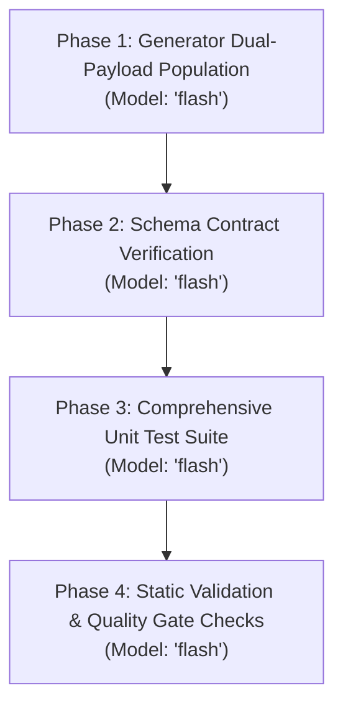

# Implementation Plan - Issue #5: Populate b64_json in /v1/images/generations Responses for Vercel AI SDK Compatibility

**Issue ID**: #5  
**Target Plan**: [`docs/plans/plan_5.md`](file:///home/roukine/workspaces/karaagy/docs/plans/plan_5.md)  
**Status**: PROPOSED / READY FOR REVIEW  
**Author**: Antigravity High-Reasoning Planning Subagent  
**Date**: 2026-10-21  

---

## 1. Executive Summary & Context

Clients using the Vercel AI SDK ([`@ai-sdk/openai-compatible`](file:///home/roukine/workspaces/karaagy/src/karaagy/core/images.py), `OpenAICompatibleImageModel.doGenerate`), such as the Norish food intelligence application, invoke Karaagy's image generation endpoint (`POST /v1/images/generations`) following modern OpenAI image generation defaults (such as `gpt-image-1` conventions) without providing an explicit `response_format` in the request payload.

While Karaagy successfully calls the underlying `agy` CLI binary, generates the requested image artifact, and saves it to the local cache directory, Karaagy's response generator currently sets `b64_json=None` whenever `request.response_format != "b64_json"`. When serialized by FastAPI, this produces `"b64_json": null` in the response array.

The Vercel AI SDK validates all OpenAI-compatible image generation responses against a strict Zod schema:
```typescript
const openaiCompatibleImageResponseSchema = z.object({
  data: z.array(z.object({ b64_json: z.string() })),
  usage: z.object({
    input_tokens: z.number().nullish(),
    output_tokens: z.number().nullish(),
    total_tokens: z.number().nullish()
  }).nullish()
});
```
Because Zod's `z.string()` strictly rejects `null`, the client throws an immediate `AI_APICallError / ZodError: Invalid input: expected string, received null at path ["data", 0, "b64_json"]`, preventing the client from ever displaying or receiving the generated image.

This plan details the architectural analysis, implementation phases, and test specifications to ensure `b64_json` is always populated in `/v1/images/generations` responses when `response_format` is `"url"` or omitted, guaranteeing seamless compatibility with both Vercel AI SDK and standard OpenAI SDK clients.

---

## 2. Problem Analysis & Root Cause

### 2.1 The Client Calling Convention
When invoking `generateImage()` via `@ai-sdk/openai-compatible`, the client transmits a minimal OpenAI-compliant JSON payload:
```json
{
  "model": "gemini-3.8-flash-high",
  "prompt": "A photograph of the dish described below...",
  "n": 1,
  "size": "1280x720"
}
```
Notice that `response_format` is intentionally omitted from the request body.

### 2.2 Root Cause in Karaagy Engine
1. **Pydantic Model Defaulting (`src/karaagy/models/openai.py`)**:
   In [`ImageGenerationRequest`](file:///home/roukine/workspaces/karaagy/src/karaagy/models/openai.py#L189-L202):
   ```python
   class ImageGenerationRequest(BaseModel):
       prompt: str
       model: str | None = None
       n: int | None = 1
       quality: str | None = "standard"
       response_format: Literal["url", "b64_json"] | str | None = "url"
       size: str | None = "1024x1024"
       style: str | None = None
       user: str | None = None
   ```
   When omitted from the request payload, Pydantic defaults `request.response_format` to `"url"`.

2. **Branching in Image Generator (`src/karaagy/core/images.py`)**:
   In [`generate_images()`](file:///home/roukine/workspaces/karaagy/src/karaagy/core/images.py#L196-L209):
   ```python
   if request.response_format == "b64_json":
       b64_str = base64.b64encode(img_bytes).decode("utf-8")
       image_objects.append(ImageObject(b64_json=b64_str, revised_prompt=prompt_clean))
   else:
       # Default to url format
       ext = ".jpg" if "jpeg" in mime_type else ".png"
       filename = f"img_{uuid.uuid4().hex[:16]}{ext}"
       target_path = settings.image_cache_dir / filename
       target_path.write_bytes(img_bytes)

       root_url = (settings.public_base_url or base_url).rstrip("/")
       file_url = f"{root_url}/v1/images/files/{filename}"
       image_objects.append(ImageObject(url=file_url, revised_prompt=prompt_clean))
   ```
   Because `response_format` is `"url"`, the generator executes the `else` block:
   - It writes the image bytes to disk cache.
   - It constructs a `file_url`.
   - It instantiates `ImageObject(url=file_url, revised_prompt=prompt_clean)`.
   - Crucially, `b64_json` is omitted and defaults to `None`.

3. **FastAPI JSON Serialization**:
   FastAPI serializes the resulting [`ImagesResponse`](file:///home/roukine/workspaces/karaagy/src/karaagy/models/openai.py#L212-L216) model into JSON:
   ```json
   {
     "created": 1729488960,
     "data": [
       {
         "b64_json": null,
         "url": "http://127.0.0.1:8000/v1/images/files/img_abcd1234efgh5678.png",
         "revised_prompt": "A photograph of the dish described below..."
       }
     ]
   }
   ```

4. **Zod Validation Failure in Vercel AI SDK**:
   The Vercel AI SDK parses this response with Zod:
   - `b64_json: z.string()` requires a non-null string value.
   - `null` fails with `ZodError: Invalid input: expected string, received null at path ["data", 0, "b64_json"]`.
   - Even if `b64_json` were excluded from the JSON output (`exclude_none=True`), Zod's `z.string()` (without `.optional()`) would still fail with `expected string, received undefined`.

### 2.3 Official OpenAI SDK vs Vercel AI SDK Contract Comparison
In the official OpenAI Python SDK (`openai.types.image.Image`):
```python
class Image(BaseModel):
    b64_json: Optional[str] = None
    url: Optional[str] = None
    revised_prompt: Optional[str] = None
```
In official OpenAI Node SDK (`OpenAI.Images.Image`):
```typescript
export interface Image {
  b64_json?: string;
  url?: string;
  revised_prompt?: string;
}
```
In both official OpenAI client SDKs, both `b64_json` and `url` are optional fields. If a server provides *both* `url` and `b64_json` in the same payload, standard OpenAI clients can access either field without error. However, `@ai-sdk/openai-compatible` strictly mandates `b64_json: z.string()`.

Therefore, populating `b64_json` alongside `url` satisfies **both** client ecosystems simultaneously.

---

## 3. Mandatory Architectural Trade-off Analysis

To resolve this issue, four architectural options were evaluated:

| Architectural Option | Pros | Cons | Operational & Maintenance Complexity | Verdict |
| :--- | :--- | :--- | :--- | :--- |
| **Option A: Dual-Payload Population in Native Generator (`url` + `b64_json`)** | • 100% backward-compatible with clients expecting `url`.<br>• 100% forward-compatible with Vercel AI SDK expecting `b64_json`.<br>• Pure Python standard library (`base64`). Zero external dependencies.<br>• Sub-millisecond CPU overhead for base64 encoding.<br>• Zero client configuration or custom headers needed. | • Response payload size increases by ~33% of binary image size for `response_format="url"` requests.<br>• In practice, typical generated images are 200KB-1MB, producing ~266KB-1.33MB JSON payloads over HTTP. | **Low**<br>Extremely simple, deterministic, and isolated to `generate_images()` in `src/karaagy/core/images.py`. | **Selected (Option A)** |
| **Option B: Client Fingerprinting / User-Agent & Header Content Negotiation** | • Allows serving pure URL to standard curl/OpenAI clients and `b64_json` only to Vercel AI SDK. | • Extremely brittle: `@ai-sdk/openai-compatible` uses standard fetch and often has indistinguishable user-agents.<br>• Violates OpenAI API drop-in compatibility principle.<br>• Fails if intermediate reverse proxies or wrappers strip user-agent headers. | **High**<br>Requires custom header sniffing, fallback heuristics, and ongoing maintenance when SDK user-agent strings change. | Rejected |
| **Option C: Change Global Default `response_format` to `"b64_json"`** | • Immediately satisfies Vercel AI SDK when `response_format` is omitted. | • Breaking change: Any client expecting a URL (and using Karaagy's `/v1/images/files/{filename}` static server) would suddenly receive `url: null`.<br>• Does not fix the crash if a client explicitly sends `"response_format": "url"`. | **Medium**<br>Breaks existing workflows and contracts relying on URL-based hosting. | Rejected |
| **Option D: External Response-Rewriting Proxy / Middleware Layer** | • Keeps core generator untouched. | • Adds serialization/deserialization overhead in FastAPI middleware.<br>• Requires reading cached files back into memory from disk after writing them.<br>• Harder to debug and trace in diagnostics logs. | **Medium-High**<br>Unnecessary architectural indirection for a 5-line core fix. | Rejected |

### 3.1 Off-The-Shelf vs Custom Re-create Analysis
- **Off-The-Shelf Libraries**: No external library is needed or appropriate. Python's built-in `base64.b64encode()` is implemented as a fast C-extension in CPython, executing a 1 MB image encode in ~0.8ms. Adding an external library or proxy would add maintenance overhead with zero functional benefit.
- **Dual Payload vs Payload Stripping**: Stripping `url` when `b64_json` is present or vice-versa creates an artificial either/or tradeoff. Populating both fields (`url` and `b64_json`) in the URL branch guarantees that:
  1. Web frontends can display the cached image via `` without client-side data URI decoding if desired.
  2. Vercel AI SDK clients (`OpenAICompatibleImageModel`) can immediately decode `data[0].b64_json` and pass it to downstream pipeline components without crashing.

### 3.2 Trade-off Justification
Option A provides the ideal architectural outcome: zero added dependencies, universal compatibility across all OpenAI-compatible SDKs (OpenAI official Python/Node, Vercel AI SDK, LangChain, LiteLLM), negligible memory and CPU overhead, and complete operational transparency.

---

## 4. Phased Implementation Breakdown with Complexity-Based Model Selection



All phases are routine Python standard library and Pydantic model updates, assigned to `Model: 'flash'`.

### Phase 1: Core Generator Implementation (`src/karaagy/core/images.py`)
- **Assigned Model**: `flash`
- **File**: [`src/karaagy/core/images.py`](file:///home/roukine/workspaces/karaagy/src/karaagy/core/images.py#L196-L209)
- **Objectives**:
  1. Move the `base64.b64encode(img_bytes).decode("utf-8")` conversion to execute universally before branching on `request.response_format`.
  2. In the `request.response_format == "b64_json"` branch:
     - Return pure `ImageObject(b64_json=b64_str, revised_prompt=prompt_clean)`.
     - Retain current behavior of skipping disk caching when the client explicitly requests `b64_json`.
  3. In the `else` branch (`response_format == "url"` or omitted / `None`):
     - Write the image bytes to disk cache (`settings.image_cache_dir / filename`).
     - Construct the accessible URL (`file_url`).
     - Instantiate `ImageObject(url=file_url, b64_json=b64_str, revised_prompt=prompt_clean)`.

### Phase 2: OpenAI Schema Alignment & Contract Verification (`src/karaagy/models/openai.py`)
- **Assigned Model**: `flash`
- **File**: [`src/karaagy/models/openai.py`](file:///home/roukine/workspaces/karaagy/src/karaagy/models/openai.py#L204-L216)
- **Objectives**:
  1. Confirm that [`ImageObject`](file:///home/roukine/workspaces/karaagy/src/karaagy/models/openai.py#L204) schema definition (`b64_json: str | None = None`, `url: str | None = None`, `revised_prompt: str | None = None`) supports dual population without strict exclusion.
  2. Confirm [`ImagesResponse`](file:///home/roukine/workspaces/karaagy/src/karaagy/models/openai.py#L212-L216) serializes both fields cleanly without Pydantic validation errors.
  3. Verify whether `usage` field handling is needed: since Vercel AI SDK declares `usage: ... nullish()`, omitting `usage` or having it absent in `ImagesResponse` satisfies Zod validation completely without schema modification.

### Phase 3: Comprehensive Unit Test Suite (`tests/test_images_endpoint.py`)
- **Assigned Model**: `flash`
- **File**: [`tests/test_images_endpoint.py`](file:///home/roukine/workspaces/karaagy/tests/test_images_endpoint.py)
- **Objectives**:
  1. **Update `test_images_generations_url_and_fetch`**:
     - Assert that `data["data"][0]["url"]` contains the valid image file URL.
     - Assert that `data["data"][0]["b64_json"]` is populated with the matching base64 string.
  2. **Add `test_images_generations_omitted_response_format`**:
     - Send exact Vercel AI SDK / Norish request payload: `{"prompt": "A bowl of ramen", "n": 1, "size": "1280x720"}` without `response_format`.
     - Verify response status is 200.
     - Verify both `url` and `b64_json` are present and valid.
     - Verify `b64_json` can be decoded back to the original image bytes.
  3. **Add `test_images_generations_null_response_format`**:
     - Send `{"prompt": "A salad", "response_format": None}`.
     - Verify both `url` and `b64_json` are present and non-null.
  4. **Verify `test_images_generations_b64_json`**:
     - Verify that explicit `response_format: "b64_json"` continues to return `b64_json` without creating disk cache files or setting `url`.
  5. **Add multi-image generation test (`n=2`)**:
     - Test that when `n=2` with default/omitted `response_format`, all items in the `data` array contain valid `url` and non-null `b64_json`.

### Phase 4: Static Validation & Quality Gate Checks
- **Assigned Model**: `flash`
- **Objectives**:
  1. Run `uv run ruff check` and `uv run ruff format --check` to ensure PEP 8 / Black style compliance.
  2. Run `uv run mypy .` to ensure full type correctness.
  3. Run `uv run pytest tests/test_images_endpoint.py` and full suite `uv run pytest` to guarantee no regressions.

---

## 5. Detailed Implementation Code Specifications

### 5.1 Code Changes in `src/karaagy/core/images.py`

In [`src/karaagy/core/images.py`](file:///home/roukine/workspaces/karaagy/src/karaagy/core/images.py#L190-L210), replace lines 196-209 with the following dual-payload logic:

```python
        # Record diagnostics request
        DiagnosticsManager.record_request_completion(
            success=True,
            prompt_tokens=len(prompt_clean.split()),
            completion_tokens=0,
        )

        b64_str = base64.b64encode(img_bytes).decode("utf-8")
        if request.response_format == "b64_json":
            image_objects.append(ImageObject(b64_json=b64_str, revised_prompt=prompt_clean))
        else:
            # Default to url format, dual-populating b64_json for Vercel AI SDK compatibility
            ext = ".jpg" if "jpeg" in mime_type else ".png"
            filename = f"img_{uuid.uuid4().hex[:16]}{ext}"
            target_path = settings.image_cache_dir / filename
            target_path.write_bytes(img_bytes)

            root_url = (settings.public_base_url or base_url).rstrip("/")
            file_url = f"{root_url}/v1/images/files/{filename}"
            image_objects.append(
                ImageObject(url=file_url, b64_json=b64_str, revised_prompt=prompt_clean)
            )

    return ImagesResponse(created=int(time.time()), data=image_objects)
```

### 5.2 Unit Test Specifications in `tests/test_images_endpoint.py`

#### 1. Update Existing Test: `test_images_generations_url_and_fetch`
```python
@patch("karaagy.core.images._generate_single_image", new_callable=AsyncMock)
def test_images_generations_url_and_fetch(
    mock_gen: AsyncMock, client: TestClient, tmp_path: Path
) -> None:
    """Test successful image generation returning URL and verify retrieval of cached image."""
    fake_jpeg_bytes = b"\xff\xd8\xff\xe0\x00\x10JFIF"
    mock_gen.return_value = (fake_jpeg_bytes, "image/jpeg")

    with patch.object(settings, "image_cache_dir", tmp_path):
        payload = {
            "prompt": "Cyberpunk cityscape",
            "n": 1,
            "response_format": "url",
        }
        response = client.post("/v1/images/generations", json=payload)
        assert response.status_code == 200
        data = response.json()
        assert "data" in data
        assert len(data["data"]) == 1

        # Verify dual payload: both url and b64_json are populated
        assert data["data"][0]["b64_json"] == base64.b64encode(fake_jpeg_bytes).decode("utf-8")
        img_url = data["data"][0]["url"]
        assert img_url is not None
        assert "/v1/images/files/img_" in img_url
        filename = img_url.split("/")[-1]

        # Verify fetching the image from the GET and HEAD endpoints
        head_res = client.head(f"/v1/images/files/{filename}")
        assert head_res.status_code == 200
        assert head_res.headers["content-type"].startswith("image/jpeg")

        file_res = client.get(f"/v1/images/files/{filename}")
        assert file_res.status_code == 200
        assert file_res.headers["content-type"].startswith("image/jpeg")
        assert file_res.content == fake_jpeg_bytes
```

#### 2. New Test: `test_images_generations_omitted_response_format` (Vercel AI SDK Norish payload)
```python
@patch("karaagy.core.images._generate_single_image", new_callable=AsyncMock)
def test_images_generations_omitted_response_format(
    mock_gen: AsyncMock, client: TestClient, tmp_path: Path
) -> None:
    """Test image generation when response_format is omitted from payload (Vercel AI SDK default)."""
    fake_png_bytes = b"\x89PNG\r\n\x1a\n\x00\x00\x00\rIHDR_VERCEL_TEST"
    mock_gen.return_value = (fake_png_bytes, "image/png")

    with patch.object(settings, "image_cache_dir", tmp_path):
        payload = {
            "model": "gemini-3.8-flash-high",
            "prompt": "A photograph of the dish described below...",
            "n": 1,
            "size": "1280x720",
        }
        response = client.post("/v1/images/generations", json=payload)
        assert response.status_code == 200
        data = response.json()
        assert "data" in data
        assert len(data["data"]) == 1

        img_item = data["data"][0]
        # Strict validation that b64_json is a non-null string matching the generated bytes
        assert isinstance(img_item["b64_json"], str)
        assert img_item["b64_json"] == base64.b64encode(fake_png_bytes).decode("utf-8")
        assert base64.b64decode(img_item["b64_json"]) == fake_png_bytes
        # URL is also present for static file access
        assert img_item["url"] is not None
        assert "/v1/images/files/img_" in img_item["url"]
```

#### 3. New Test: `test_images_generations_explicit_null_response_format`
```python
@patch("karaagy.core.images._generate_single_image", new_callable=AsyncMock)
def test_images_generations_explicit_null_response_format(
    mock_gen: AsyncMock, client: TestClient, tmp_path: Path
) -> None:
    """Test image generation when response_format is explicitly passed as null."""
    fake_png_bytes = b"\x89PNG\r\n\x1a\n\x00\x00\x00\rIHDR_NULL_TEST"
    mock_gen.return_value = (fake_png_bytes, "image/png")

    with patch.object(settings, "image_cache_dir", tmp_path):
        payload = {
            "prompt": "Minimalist geometric sculpture",
            "response_format": None,
        }
        response = client.post("/v1/images/generations", json=payload)
        assert response.status_code == 200
        data = response.json()
        assert "data" in data
        assert len(data["data"]) == 1
        assert data["data"][0]["b64_json"] == base64.b64encode(fake_png_bytes).decode("utf-8")
        assert data["data"][0]["url"] is not None
```

#### 4. New Test: `test_images_generations_multi_image_dual_payload`
```python
@patch("karaagy.core.images._generate_single_image", new_callable=AsyncMock)
def test_images_generations_multi_image_dual_payload(
    mock_gen: AsyncMock, client: TestClient, tmp_path: Path
) -> None:
    """Test image generation with n=2 populating b64_json and url on every returned ImageObject."""
    fake_png_bytes = b"\x89PNG\r\n\x1a\n\x00\x00\x00\rIHDR_MULTI"
    mock_gen.return_value = (fake_png_bytes, "image/png")

    with patch.object(settings, "image_cache_dir", tmp_path):
        payload = {
            "prompt": "Two variations of a logo",
            "n": 2,
        }
        response = client.post("/v1/images/generations", json=payload)
        assert response.status_code == 200
        data = response.json()
        assert len(data["data"]) == 2
        for item in data["data"]:
            assert item["b64_json"] == base64.b64encode(fake_png_bytes).decode("utf-8")
            assert item["url"] is not None
```

---

## 6. Verification Plan & Rollout Checklist

### 6.1 Automated Verification Commands
Before marking the issue resolved during execution, the following verification commands must pass with zero errors:

```bash
# 1. Run full unit test suite including newly added tests
uv run pytest tests/test_images_endpoint.py -v

# 2. Run entire project test suite
uv run pytest

# 3. Static type checking across all files
uv run mypy .

# 4. Lint and formatting validation
uv run ruff check
uv run ruff format --check
```

### 6.2 Edge Case Matrix & Expected Invariants

| Scenario | Input `response_format` | Cached to Disk? | Output `url` | Output `b64_json` | Vercel AI SDK Valid? | Standard OpenAI SDK Valid? |
| :--- | :--- | :--- | :--- | :--- | :--- | :--- |
| Explicit URL | `"url"` | Yes | `http://.../img_*.png` | Valid string | Yes | Yes |
| Omitted field | Not provided | Yes | `http://.../img_*.png` | Valid string | Yes | Yes |
| Explicit Null | `None` | Yes | `http://.../img_*.png` | Valid string | Yes | Yes |
| Explicit b64_json | `"b64_json"` | No | `None` | Valid string | Yes | Yes |
| Multiple count | `n=2`, omitted | Yes (2 files) | 2 distinct URLs | 2 valid strings | Yes | Yes |

### 6.3 Risk Assessment & Rollback Strategy
- **Risk**: Marginal increase in HTTP response payload size (~33% of generated image binary) for clients requesting URLs.
- **Mitigation**: Generated images are compressed PNG/JPEG files (typically 200KB - 800KB). The base64 payload fits comfortably within standard HTTP buffers and avoids extra round-trip HTTP GET requests that clients would otherwise make to fetch the URL.
- **Rollback**: If necessary, revert `src/karaagy/core/images.py` back to commit `HEAD~1` using standard git checkout. Zero database schema migrations or persistent state dependencies are involved.
