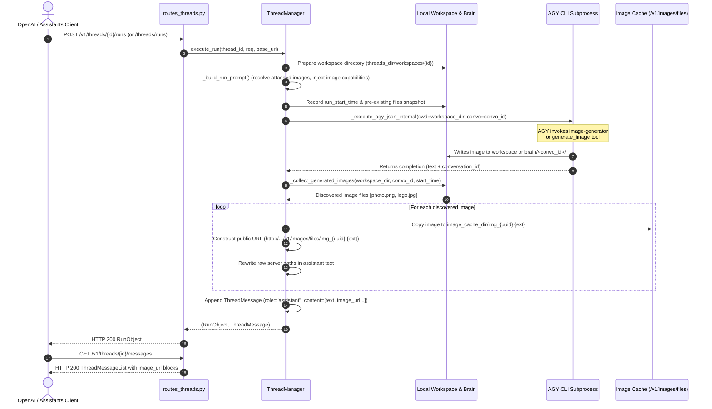

# Implementation Plan - Issue #7: Unifier la génération d'images en 1 seul appel via exécution native par AGY dans les threads

**Issue ID**: #7  
**Target Plan**: [`docs/plans/plan_7.md`](file:///home/roukine/workspaces/karaagy/docs/plans/plan_7.md)  
**Status**: DRAFT / READY FOR REVIEW  
**Author**: Senior Software & System Architect Subagent  
**Date**: 2026-10-21  

---

## 1. Executive Summary & Context

Currently, client applications (such as VoizocheBot or web frontends) wishing to interactively generate or edit images within a conversational thread must execute a two-step calling convention:
1. `POST /v1/threads/{thread_id}/runs`: Karaagy executes the thread conversation turn (~15s) and outputs an assistant text message containing a pseudo-directive (e.g. `[IMAGE: description...]`).
2. `POST /v1/images/generations`: The client parses the pseudo-tag and issues a dedicated call with the extracted prompt (~45s), triggering an isolated subprocess `agy -p ...` in a temporary folder.

### Critical Deficiencies of the 2-Call Pattern:
- **Excessive Cumulative Latency**: 60s total round-trip time, severely impairing conversational user experience.
- **Repeated Cold Starts**: AGY CLI process initialization overhead is paid twice.
- **Context & State Severance**: The dedicated image generation process lacks conversational context, thread history, and access to attached source images, preventing authentic Image-to-Image refinement and multi-turn iterative editing.

### Target Architecture (Unified Native Execution):
Enable the Antigravity agent during a thread run (`ThreadManager.execute_run` and `ThreadManager.execute_run_stream`) to invoke its native image generation capabilities (built-in `generate_image` tool, `image-generator` subagent, or filesystem artifact output). Karaagy monitors the thread's isolated workspace and conversation brain directories, automatically migrates generated image artifacts into Karaagy's managed image cache (`/v1/images/files/{filename}`), and returns an OpenAI-standard multimodal `ThreadMessage` containing both `text` and `image_url` content blocks.

---

## 2. Problem Analysis & Technical Mechanics

### 2.1 Workspace Isolation
Currently, `_execute_agy_json_internal` and `_execute_agy_stream_internal` in [`src/karaagy/core/process.py`](file:///home/roukine/workspaces/karaagy/src/karaagy/core/process.py#L72-L120) default `cwd` to `Path.cwd()` (the project root). If multiple threads execute concurrent runs, unisolated file writes risk race conditions, collision, and cross-thread data leaks.
- **Solution**: Allocate a dedicated working directory per thread:
  `workspace_dir = settings.threads_dir / "workspaces" / thread_id`
  Pass this path as `cwd` to all subprocess invocations for that thread.

### 2.2 AGY Image Output Locations
When AGY executes an agent turn with image generation capabilities, images are produced across three potential locations:
1. **Thread Workspace**: Direct files written to `cwd` (`.png`, `.jpg`, `.jpeg`, `.webp`, `.gif`, `.svg`).
2. **Conversation Brain Artifacts**: `~/.gemini/antigravity-cli/brain/<convo_id>/` (where AGY's `generate_image` tool saves files such as `<name>_<timestamp>.jpg`, and `.tempmediaStorage/`).
3. **Subagent Brain Artifacts**: `~/.gemini/antigravity-cli/brain/<subagent_convo_id>/` spawned during turn execution.

Because checking filesystem directories with timestamp filtering (`st_mtime >= run_start_time - 1.0`) executes in ~5 ms across local directories, Karaagy can reliably sweep:
- The thread workspace directory recursively.
- The thread's `conversation_id` brain directory.
- Any subagent brain directory created during the run interval.
- Any raw local file paths matching image patterns cited in the assistant's output text or transcript media metadata.

### 2.3 Image Cache Migration & URL Exposure
Discovered image files are migrated into Karaagy's public cache:
- Target: `settings.image_cache_dir / f"img_{uuid.uuid4().hex[:16]}.{ext}"`
- Accessible via existing route: `GET /v1/images/files/{filename}` with HTTP 200, caching headers, and automatic 24h TTL pruning.
- Public URL constructed via `(settings.public_base_url or base_url).rstrip("/") + f"/v1/images/files/{filename}"`.

### 2.4 Assistant Message Multimodal Compatibility & Path Rewriting
To maintain 100% backward compatibility with diverse OpenAI client SDKs:
1. **Multimodal Content Block**:
   The assistant `ThreadMessage.content` is structured as:
   ```json
   [
     {"type": "text", "text": {"value": "Voici l'illustration générée !"}},
     {"type": "image_url", "image_url": {"url": "http://127.0.0.1:8000/v1/images/files/img_abcdef1234567890.jpg"}}
   ]
   ```
2. **Text Fallback Preservation**:
   Clients that naively inspect `msg.content[0]["text"]["value"]` continue to work without modification because the text block remains the first element in the list.
3. **Local Path Rewriting**:
   If the agent's text response mentions the internal container path (e.g. `/home/roukine/.../img_123.jpg` or `[Image saved at /tmp/...]`), Karaagy automatically replaces that local file path with the accessible public HTTP URL in the assistant's text content.

### 2.5 Base URL Context Propagation
Routes [`create_thread_run`](file:///home/roukine/workspaces/karaagy/src/karaagy/api/routes_threads.py#L129-L175) and [`create_thread_and_run`](file:///home/roukine/workspaces/karaagy/src/karaagy/api/routes_threads.py#L178-L215) must inject FastAPI's `Request` object and pass `base_url = str(request.base_url).rstrip("/")` down into `ThreadManager.execute_run()` and `ThreadManager.execute_run_stream()`.

### 2.6 Streaming Runs (`execute_run_stream`)
In streaming mode:
- Standard SSE chunks (`data: {"choices": [{"delta": {"content": "..."}}]}`) stream to the client as generated by AGY.
- Upon completion of the AGY process stream, Karaagy scans for generated images.
- If images are found, Karaagy yields an additional SSE text delta chunk appending markdown image links (e.g. `\n\n\n\n`) prior to yielding `data: [DONE]`.
- The final persisted `ThreadMessage` in `ThreadState.messages` stores the full multimodal content array.

### 2.7 Multimodal Image-to-Image Acceleration
When a user message contains an image attachment:
- If the URL is an existing Karaagy cached file (`http://.../v1/images/files/img_xxx.jpg`), Karaagy directly resolves it to the local cache path `settings.image_cache_dir / "img_xxx.jpg"`, bypassing unnecessary network roundtrips.
- If the URL is a remote HTTP/HTTPS link, Karaagy securely downloads the file to ephemeral storage with strict bounds (5s timeout, 15MB size limit) using standard library `urllib.request`.
- The resolved path is formatted as `[Attached Image File: /path/to/img]` in the prompt, allowing AGY's tools to read the source image directly from disk for Image-to-Image editing.

### 2.8 Thread Lifecycle & Garbage Collection
When a thread is deleted (`ThreadManager.delete_thread`) or expired after 7 days (`ThreadManager.prune_expired_threads`), its dedicated workspace directory `settings.threads_dir / "workspaces" / thread_id` is automatically purged alongside AGY conversation brain storage.

---

## 3. Mandatory Architectural Trade-off Analysis

| Dimension | Option A: 100% Custom Re-Create In-House Primitive | Option B: Pragmatic Hybrid with Per-Thread Workspaces & Multi-Tier Artifact Detection (Selected) | Option C: Heavy External Framework (Ephemeral Docker Containers + MinIO/S3 + Celery) |
| :--- | :--- | :--- | :--- |
| **Description** | Monolithic shared working directory with inotify kernel file-watchers and AST stdout regex parsing of tool calls. | Per-thread isolated workspace directories (`threads_dir / "workspaces" / {id}`), subprocess `cwd` injection, filesystem snapshot/mtime delta sweep across workspace and brain directories, copying to local cache. | Ephemeral Docker container sandbox per thread run, mounting S3/MinIO volumes, with Celery worker queue orchestration. |
| **Pros** | - No per-thread directory creation overhead.<br>- Fast event notifications on Linux. | - Clean filesystem isolation between concurrent threads.<br>- Zero cross-platform kernel dependencies (no Linux-only inotify).<br>- Catches artifacts from any tool (`generate_image`, subagent, python script, bash).<br>- Reuses existing Karaagy image cache, TTL management, and `/v1/images/files/` serving routes.<br>- Sub-millisecond cleanup. | - Complete process and filesystem isolation.<br>- Cloud-native persistent artifact storage across distributed nodes. |
| **Cons** | - Severe race conditions under concurrent thread runs.<br>- Linux-specific (`inotify` / `epoll`).<br>- Misses artifacts generated by subagents in isolated brain paths.<br>- High complexity of managing async watcher lifecycles. | - Requires directory creation and cleanup upon thread deletion.<br>- Ephemeral disk IO for moving image files into image cache. | - Extreme latency overhead (several seconds to spin up containers).<br>- Incompatible with lightweight local deployments.<br>- High operational maintenance (Docker daemon, MinIO, Redis, Celery).<br>- Strips Portainer stack metadata if not handled cautiously. |
| **Operational & Maintenance Complexity** | **High**: Fragile event loop watcher hooks, risks memory leaks on hanging watchers, complex concurrency locking. | **Low**: Pure Python standard library (`pathlib`, `shutil`, `time`, `uuid`), zero extra external dependencies, adheres strictly to YAGNI and existing project architecture. | **Extremely High**: Requires multi-container setup, daemon credentials, storage provisioning, network bridge configuration. |
| **Trade-off Justification** | Rejected due to concurrency hazards in shared folders and OS-level lock-in. | **Selected**: Provides rock-solid concurrency isolation, low operational overhead, robust multi-source image detection, and instant client compatibility. | Rejected as severe over-engineering that violates performance bounds and YAGNI. |

---

## 4. Target Architecture & Component Design

### 4.1 Execution Sequence Diagram



### 4.2 Workspace & Cache Directory Structure

```
~/.gemini/antigravity-cli/
├── karaagy_threads/
│   ├── thread_abc123.json            <-- Thread metadata and messages
│   └── workspaces/
│       └── thread_abc123/            <-- Isolated CWD for thread run
│           └── generated_art.png     <-- Ephemeral working files
├── brain/
│   └── <convo_id>/
│       ├── .tempmediaStorage/
│       └── art_1790322.jpg           <-- AGY tool-generated files
└── /tmp/karaagy_images_cache/        <-- Karaagy managed image cache
    └── img_9f8e7d6c5b4a.jpg          <-- Served by /v1/images/files/{filename}
```

---

## 5. Implementation Phases & Step-by-Step Task List

### Phase 1: Configuration, Request Context & Base URL Injection
**Model Assigned**: `flash` (Schema & Route plumbing)

- [ ] **Task 1.1: Settings & Defaults Verification** ([`src/karaagy/config.py`](file:///home/roukine/workspaces/karaagy/src/karaagy/config.py))
  - Verify `threads_dir`, `image_cache_dir`, `image_cache_ttl_seconds`, and `public_base_url`.
  - Add `enable_native_image_generation: bool = True` to [`KaraagySettings`](file:///home/roukine/workspaces/karaagy/src/karaagy/config.py#L10-L38).
- [ ] **Task 1.2: Route Request Context Injection** ([`src/karaagy/api/routes_threads.py`](file:///home/roukine/workspaces/karaagy/src/karaagy/api/routes_threads.py))
  - Update `create_thread_run` and `create_thread_and_run` route signatures to accept `http_request: Request`.
  - Extract `base_url = str(http_request.base_url).rstrip("/")`.
  - Pass `base_url=base_url` to `ThreadManager.execute_run()` and `ThreadManager.execute_run_stream()`.

### Phase 2: Thread Workspace Lifecycle Management
**Model Assigned**: `flash` (Filesystem primitives)

- [ ] **Task 2.1: Workspace Resolution Helper** ([`src/karaagy/core/threads.py`](file:///home/roukine/workspaces/karaagy/src/karaagy/core/threads.py))
  - Implement `ThreadManager._get_thread_workspace(thread_id: str) -> Path`.
  - Ensure sanitized thread ID validation prevents directory traversal.
  - Automatically create directory: `workspace_dir.mkdir(parents=True, exist_ok=True)`.
- [ ] **Task 2.2: Workspace Cleanup on Deletion & Expiration** ([`src/karaagy/core/threads.py`](file:///home/roukine/workspaces/karaagy/src/karaagy/core/threads.py))
  - In `ThreadManager.delete_thread(thread_id)`: remove `workspace_dir` via `shutil.rmtree(workspace_dir, ignore_errors=True)`.
  - In `ThreadManager.prune_expired_threads()`: clean up corresponding workspace directories for expired threads.

### Phase 3: Multimodal Image-to-Image & Prompt Capability Guidance
**Model Assigned**: `flash` (Prompt engineering & URL parsing)

- [ ] **Task 3.1: Local Cached Image URL Shortcut** ([`src/karaagy/core/prompt.py`](file:///home/roukine/workspaces/karaagy/src/karaagy/core/prompt.py#L21-L43))
  - In `_process_image_url(url, tracked_files)`: detect `/v1/images/files/{filename}`.
  - Resolve directly to local `settings.image_cache_dir / filename` if the file exists on disk.
  - Return `[Attached Image File: {cached_path}]` without making outbound network requests.
- [ ] **Task 3.2: Safe Remote Image Fetching** ([`src/karaagy/core/prompt.py`](file:///home/roukine/workspaces/karaagy/src/karaagy/core/prompt.py))
  - For external `http://` and `https://` URLs, implement safe download using `urllib.request.urlopen` with timeout=5.0s and 15MB limit into `TEMP_IMAGE_DIR`.
  - Track downloaded file in `tracked_files` for automatic cleanup post-run.
- [ ] **Task 3.3: Native Image Generation Capability Instructions** ([`src/karaagy/core/threads.py`](file:///home/roukine/workspaces/karaagy/src/karaagy/core/threads.py#L221-L277))
  - In `_build_run_prompt()`, append native generation capability guidance if `settings.enable_native_image_generation` is True:
    *"When requested to create, generate, draw, or edit images, produce the image natively using your image generation tools or write the image file directly to the current workspace. Do not output raw [IMAGE: ...] pseudo-tags."*

### Phase 4: Artifact Detection, Cache Migration & Response Formatting
**Model Assigned**: `pro` (Core logic, concurrency & streaming)

- [ ] **Task 4.1: Artifact Scanner Implementation** ([`src/karaagy/core/threads.py`](file:///home/roukine/workspaces/karaagy/src/karaagy/core/threads.py))
  - Implement `ThreadManager._collect_and_cache_images(thread_id, convo_id, workspace_dir, run_start_time, base_url, assistant_text) -> tuple[list[dict[str, Any]], str]`.
  - Sweep `workspace_dir` recursively for image extensions (`.png`, `.jpg`, `.jpeg`, `.webp`, `.gif`, `.svg`) with `mtime >= run_start_time - 1.0`.
  - If `convo_id` is present, sweep `settings.antigravity_home / "brain" / convo_id` and any brain subagent folders modified after `run_start_time - 1.0`.
  - Extract any existing file paths cited in `assistant_text` or transcript media.
  - For each valid image:
    - Generate unique target name: `img_{uuid.uuid4().hex[:16]}.{ext}`.
    - Copy image to `settings.image_cache_dir`.
    - Construct public URL: `f"{effective_base_url}/v1/images/files/{filename}"`.
    - Build multimodal content part: `{"type": "image_url", "image_url": {"url": public_url}}`.
    - Replace references to the local file path in `assistant_text` with the `public_url`.
- [ ] **Task 4.2: Integrate into Synchronous Run** ([`ThreadManager.execute_run`](file:///home/roukine/workspaces/karaagy/src/karaagy/core/threads.py#L279-L355))
  - Pass `cwd=workspace_dir` to `_execute_agy_json_internal`.
  - Call `_collect_and_cache_images()` after completion.
  - Build multimodal `content` list: text part first, followed by `image_url` parts.
  - Save `CreateThreadMessageRequest(role="assistant", content=content_list)`.
- [ ] **Task 4.3: Integrate into Streaming Run** ([`ThreadManager.execute_run_stream`](file:///home/roukine/workspaces/karaagy/src/karaagy/core/threads.py#L357-L426))
  - Pass `cwd=workspace_dir` to `_execute_agy_stream_internal`.
  - After stream process exits, invoke `_collect_and_cache_images()`.
  - If new images were generated and are not already in markdown format in the streamed text, yield an SSE delta chunk containing `\n\n\n\n` prior to `data: [DONE]`.
  - Save the completed multimodal assistant message in thread history.

### Phase 5: Automated Test Suite & Regression Verification
**Model Assigned**: `flash` (Unit tests & mock fixtures)

- [ ] **Task 5.1: Thread Workspace Isolation Tests** ([`tests/test_threads.py`](file:///home/roukine/workspaces/karaagy/tests/test_threads.py))
  - Verify workspace directory creation under `threads_dir / "workspaces" / thread_id`.
  - Verify that `cwd` passed to `_execute_agy_json_internal` is the isolated workspace.
  - Verify workspace directory is deleted when thread is deleted or pruned.
- [ ] **Task 5.2: Native Image Ingestion & Cache Migration Tests** ([`tests/test_threads.py`](file:///home/roukine/workspaces/karaagy/tests/test_threads.py))
  - Mock `_execute_agy_json_internal` to simulate image creation in the workspace during run.
  - Verify image is copied to `image_cache_dir` with `img_` prefix.
  - Verify assistant message contains both `text` and `image_url` content blocks.
  - Verify local filesystem paths in assistant text are rewritten to public URLs.
- [ ] **Task 5.3: Image-to-Image Local URL Shortcut Tests** ([`tests/test_threads.py`](file:///home/roukine/workspaces/karaagy/tests/test_threads.py))
  - Provide user message with `http://localhost:8000/v1/images/files/img_test.jpg`.
  - Verify prompt builder resolves directly to `[Attached Image File: /.../img_test.jpg]`.
- [ ] **Task 5.4: Streaming Run Image Markdown Delta Tests** ([`tests/test_threads.py`](file:///home/roukine/workspaces/karaagy/tests/test_threads.py))
  - Verify streaming run emits image markdown delta and saves multimodal message.
- [ ] **Task 5.5: Static Analysis & Test Suite Validation**
  - Execute `uv run ruff check .`
  - Execute `uv run ruff format --check .`
  - Execute `uv run mypy .`
  - Execute `uv run pytest tests/test_threads.py -v`
  - Execute `uv run pytest tests/test_images.py -v`

---

## 6. Testing Strategy & Verification Plan

### Test Matrix

| Test Case | Condition | Expected Result |
| :--- | :--- | :--- |
| **TC-1: Workspace Isolation** | Execute run on `thread_123` | Subprocess executes with `cwd=.../workspaces/thread_123`. |
| **TC-2: Image Artifact Detection** | AGY writes `output.png` into workspace during run | `output.png` copied to `image_cache_dir/img_{uuid}.png`. Assistant message contains `{"type": "image_url", "image_url": {"url": "http://.../v1/images/files/img_{uuid}.png"}}`. |
| **TC-3: Text Path Replacement** | Assistant text says `"Image saved at /path/to/output.png"` | Persisted text replaced with `"Image saved at http://.../v1/images/files/img_{uuid}.png"`. |
| **TC-4: Backward Compatibility** | Client inspects `msg.content[0]["text"]["value"]` | Returns valid string containing assistant text. |
| **TC-5: Image-to-Image Resolution** | User message contains `/v1/images/files/img_prev.jpg` | Prompt builder directly attaches local file path without HTTP fetch. |
| **TC-6: Streaming Image Delta** | Streaming run generates image | Stream yields markdown delta `` before `data: [DONE]`. |
| **TC-7: Workspace Purge on Delete** | Call `DELETE /v1/threads/{id}` | Workspace directory completely deleted from filesystem. |
| **TC-8: Workspace Purge on Prune** | Thread exceeds TTL (`thread_ttl_seconds`) | `prune_expired_threads()` deletes both JSON file and workspace directory. |

---

## 7. Continuous Learning & Architectural Guardrails

1. **Strict Portainer & Watchtower Non-Interference**: All enhancements remain within Karaagy gateway application logic. No container reinstantiations or docker socket bindings are introduced.
2. **Standard Library Over Heavy Dependencies**: Image downloading and file sweeping rely exclusively on standard library modules (`pathlib`, `urllib.request`, `shutil`, `uuid`), strictly respecting YAGNI and keeping dependencies minimal.
3. **Double-Safety Cache Expiration**: Images produced through native thread runs share the standard 24h TTL cache and cleanup loops of `/v1/images/generations`, preventing storage leaks.
4. **Decoupled URL Construction**: Always prefer `settings.public_base_url` over request host header to support reverse-proxy and tunnel setups (e.g. Cloudflare Tunnels, Traefik).
